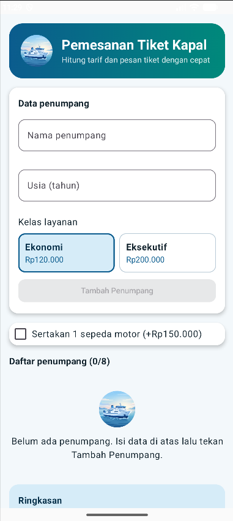
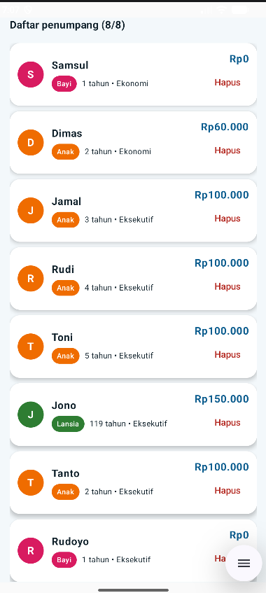
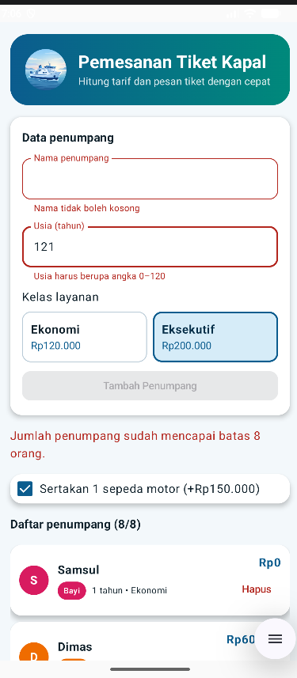
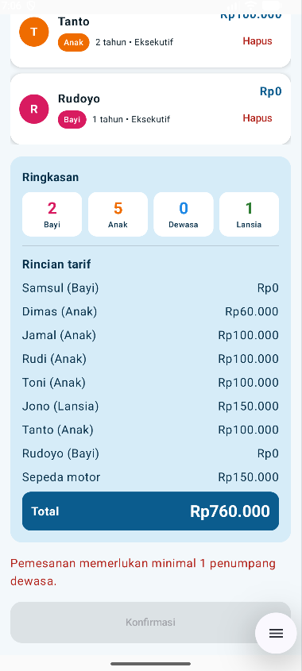

# FerryGo - UTS PBM 2026 Kelompok 07

**Kasus 5: Pemesanan Tiket Kapal Penyeberangan**

Aplikasi Android satu layar (Kotlin dan Jetpack Compose) untuk menghitung tarif pemesanan tiket kapal penyeberangan berdasarkan usia, kelas layanan, dan tambahan sepeda motor.

## Anggota

| No | Nama | NIM | Akun GitHub |
|----|------|-----|-------------|
| 1 | [M. Al Furqan] | 2305903040038 | https://github.com/malfurqan https://github.com/furqan2234 |
| 2 | Fattul Ula | 2305903040076 | https://github.com/fathululaganteng |
| 3 | Lisa Rahmadani Ismail L | 2305903040089 | https://github.com/lisarahmadaniismail24 |
| 4 | Jastri Nurul Hayani | 2305903040049 | https://github.com/jastrinurulhayani4 |

## Video

[(https://youtu.be/2QMsZq3bCUE?si=64kwrAZgogZV8LpG)]

## Tangkapan Layar

| Keadaan kosong | Berisi data | Pesan kesalahan |
|:--:|:--:|:--:|
|  |  |  |

## Cara Menjalankan

1. Pasang Android Studio versi stabil terbaru.
2. Clone repositori: `git clone https://github.com/furqan2234/uts-pbm-2026-kelompok-07.git`
3. Buka folder hasil clone di Android Studio (**File > Open**) dan tunggu Gradle Sync selesai.
4. Jalankan di emulator atau ponsel Android dengan tombol **Run**.